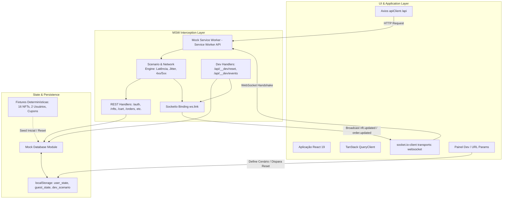
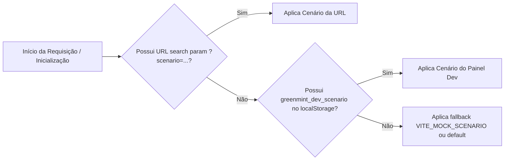

# Plano de Implementação: Contratos e Mocks (MSW + Socket.IO)

> **Baseado na especificação:** [_specs/contratos-e-mocks.spec.md](file:///home/savior/coding/nft-marketplace/_specs/contratos-e-mocks.spec.md)  
> **Specs herdadas:** [_specs/base.spec.md](file:///home/savior/coding/nft-marketplace/_specs/base.spec.md) e [_specs/fundation.spec.md](file:///home/savior/coding/nft-marketplace/_specs/fundation.spec.md)  
> **Objetivo:** Implementar a camada completa de simulação de rede (REST + Socket.IO) e contratos tipados compartilhados para o marketplace de NFTs GreenMint (Kurio), com estado determinístico isolado por usuário em `localStorage`, idempotência de pedidos, 12 cenários configuráveis e compatibilidade garantida no build da Vercel.

---

## User Review Required

> [!IMPORTANT]
> **Decisões do Usuário já Incorporadas:**
>
> 1. **Avatar:** Armazenado como Data URL (Base64 compactada com limite de ~100KB) persistido na chave do usuário no `localStorage`.
> 2. **Token de Autenticação:** JWT simulado codificado em Base64 com payload padronizado (`sub`, `email`, `role`, `iat`, `exp`), permitindo inspeção de expiração no cliente.
> 3. **Disparo de Eventos nos Testes:** Rota HTTP utilitária do MSW (`POST /api/__dev/events`), permitindo ao Playwright emitir eventos de tempo real sem hacks de injeção em janela.
> 4. **Merge de Carrinho:** Ao efetuar login, os itens do carrinho de visitante são mesclados com o carrinho do usuário, somando quantidades com respeito ao teto de estoque disponível.

> [!WARNING]
> **Risco Crítico Arquitetural - Socket.IO com MSW:**
> O `@mswjs/socket.io-binding` atua exclusivamente interceptando a API `window.WebSocket` nativa do navegador e **NÃO** suporta o fallback por HTTP long-polling. Por este motivo, o cliente `socket.io-client` **deve obrigatoriamente** ser configurado com `transports: ['websocket']`.  
> Conforme definido na spec, **o Passo 1 da implementação é uma Prova de Conceito (PoC) mínima isolada** para validar a conexão e a emissão de eventos antes de avançar para as demais rotas.

---

## Arquitetura Geral da Camada de Mocks



---

## Precedência e Seleção de Cenários (RN-15)



---

## Proposed Changes

---

### Passo 1: Prova de Conceito (PoC) Mínima do Socket.IO com MSW

Validar imediatamente a viabilidade do Socket.IO interceptado pelo MSW no navegador e em testes antes de escrever qualquer handler de negócio.

#### Dependências a Instalar

- `msw` (v2.x)
- `@mswjs/socket.io-binding`
- `socket.io-client`

#### Inicialização do Service Worker

- Executar `npx msw init public/ --save` para criar `public/mockServiceWorker.js`.

#### [NEW] `src/lib/socket-client.ts`

- Instância singleton do `socket.io-client` apontando para a URL base da aplicação com:
  ```typescript
  import { io, Socket } from "socket.io-client";

  export const socketClient: Socket = io(window.location.origin, {
    transports: ["websocket"], // Obrigatório para interceptação com @mswjs/socket.io-binding
    autoConnect: false,
  });
  ```

#### [NEW] `src/mocks/socket/poc-handler.ts`

- Handler WebSocket com protocolo `SocketIo` para testar handshake e emissão do evento `"nft.updated"`:
  ```typescript
  import { ws } from "msw";
  import { SocketIo } from "@mswjs/socket.io-binding";

  const chat = ws.link(`${window.location.origin}/socket.io`, {
    protocol: new SocketIo(),
  });
  ```

#### Validação do Passo 1

- Criar rotina simples de teste/verificação no console do navegador ou script de teste que:
  1. Inicia o worker MSW com o handler do socket.
  2. Conecta `socketClient.connect()`.
  3. O mock emite evento `"nft.updated"` com payload `{ eventId: "test-1", resource: "nft", resourceId: "nft-01", version: 1 }`.
  4. O listener do cliente recebe a mensagem e confirma no console o sucesso da PoC.

---

### Passo 2: Contratos Tipados TypeScript Compartilhados (`src/contracts/`)

Centralizar todas as tipagens de DTOs, requisições, respostas e eventos em um módulo unificado para servir de fonte da verdade para o cliente Axios, React Query e handlers MSW ([RN-20](file:///home/savior/coding/nft-marketplace/_specs/base.spec.md#L98)).

#### [NEW] `src/contracts/common.ts`

- Tipagem para valores em ETH como strings decimais ([RN-01](file:///home/savior/coding/nft-marketplace/_specs/base.spec.md#L79)):
  ```typescript
  export type EthAmount = string; // Ex: "0.45", "1.2000"
  ```
- Tipagem para paginação padronizada:
  ```typescript
  export interface PaginationMeta {
    page: number;
    limit: number;
    totalItems: number;
    totalPages: number;
    hasNextPage: boolean;
    hasPrevPage: boolean;
  }

  export interface PaginatedResponse<T> {
    items: T[];
    pagination: PaginationMeta;
  }
  ```
- Tipagem padronizada de erro da API:
  ```typescript
  export type ApiErrorCode =
    | "VALIDATION_ERROR"
    | "UNAUTHORIZED"
    | "FORBIDDEN"
    | "NOT_FOUND"
    | "CONFLICT"
    | "TRANSIENT_ERROR"
    | "INSUFFICIENT_FUNDS"
    | "EXPIRED_RESOURCE";

  export interface ApiErrorDetail {
    field?: string;
    message: string;
  }

  export interface ApiErrorResponse {
    code: ApiErrorCode;
    message: string;
    details?: ApiErrorDetail[];
    timestamp: string;
  }
  ```

#### [NEW] `src/contracts/auth.ts`

- Interfaces de usuário (`UserDTO`), credenciais, `RegisterRequest`, `LoginRequest`, `AuthResponse` e payload do token JWT simulado (`JwtPayloadDTO`: `sub`, `email`, `role`, `iat`, `exp`).

#### [NEW] `src/contracts/nft.ts`

- Interfaces de NFT resumido (`NftSummaryDTO`) e detalhado (`NftDetailDTO`), edições (`NftEditionDTO`), atributos/propriedades, filtros (`category`, `status`, `priceMin`, `priceMax`, `search`, `sort`) e tiragens.

#### [NEW] `src/contracts/favorites.ts`

- DTOs para lista de favoritos, inclusão e remoção.

#### [NEW] `src/contracts/cart.ts`

- DTOs de item de carrinho (`CartItemDTO`), carrinho consolidado (`CartDTO`), adições e atualizações de quantidade.

#### [NEW] `src/contracts/quote.ts`

- DTOs de cotação oficial (`QuoteResponse`: `subtotalEth`, `discountEth`, `networkFeeEth`, `totalEth`, `coupon`, `expiresAt`), cupons (`CouponDTO`).

#### [NEW] `src/contracts/order.ts`

- DTOs de criação de pedido (`CreateOrderRequest`), cabeçalho `Idempotency-Key`, recibo imutável (`OrderReceiptDTO`) e status (`pending`, `confirmed`, `refused`).

#### [NEW] `src/contracts/wallet.ts`

- DTOs de carteiras (`WalletDTO`), redes e saldos simulados.

#### [NEW] `src/contracts/profile.ts`

- DTOs de perfil (`UserProfileDTO`), alteração de senha e avatar em Base64 Data URL.

#### [NEW] `src/contracts/events.ts`

- DTOs dos eventos Socket.IO envelopados (`NftUpdatedEvent`, `OrderUpdatedEvent`).

#### [NEW] `src/contracts/index.ts`

- Barrel export de todos os contratos tipados.

---

### Passo 3: Fixtures Determinísticas (`src/mocks/fixtures/`)

Dados estáticos reproduzíveis para garantir testes consistentes e ausência de flutuações em testes de regressão visual.

#### [NEW] `src/mocks/fixtures/users.ts`

- **Alice Vance (`alice@greenmint.io`):** Usuário padrão autenticado, com senha hash `hash_v1_alice_valid`, carteiras MetaMask (4.50 ETH) e Coinbase (Polygon), favoritos iniciais (`nft-01`, `nft-04`).
- **Bob Martinez (`bob@greenmint.io`):** Usuário iniciante sem carteiras cadastradas, para testar fluxos de onboarding e checkout do zero.

#### [NEW] `src/mocks/fixtures/nfts.ts`

- Array determinístico de 16 NFTs com metadados detalhados:
  - 4 categorias (`art`, `collectibles`, `music`, `photography`).
  - Status distribuídos (`on_sale`, `last_editions`, `sold_out`).
  - Preços em ETH variando de `"0.05"` a `"12.50"`.
  - Imagens com dimensões pré-computadas para prevenção de layout shift.

#### [NEW] `src/mocks/fixtures/coupons.ts`

- `KURIO10`: Válido (10% desconto, expiração em 2030).
- `VERAO2026`: Expirado (20% desconto, expiração no passado).

#### [NEW] `src/mocks/fixtures/wallets.ts`

- Dados de carteiras e provedores simulados.

---

### Passo 4: Motor de Estado Simulado, Persistência e Reset (`src/mocks/db/`)

Manter o estado consistente entre todas as entidades com isolamento estrito por usuário e restauração por reset ([RN-13](file:///home/savior/coding/nft-marketplace/_specs/base.spec.md#L91)).

#### [NEW] `src/mocks/db/storage.ts`

- Abstração segura com `try/catch` para leitura e gravação em `localStorage`, prevenindo quebras em caso de quota cheia ou navegação anônima restritiva (com fallback gracioso em memória).

#### [NEW] `src/mocks/db/index.ts`

- Repositório em memória gerenciado:
  - `getUserState(userId)` e `saveUserState(userId, state)`
  - `getGuestState()` e `saveGuestState(state)`
  - `getNfts(query)` (busca, filtros combináveis, ordenação, paginação)
  - `getNftById(id)`
  - `updateNftStockAndPrice(id, newStock, newPrice)`
  - `getCart(userId | null)` e operações de itens
  - `mergeGuestCartIntoUserCart(userId)`
  - `calculateQuote(items, couponCode)`
  - `createOrderWithIdempotency(userId, idempotencyKey, payload)`
  - `updateUserProfile(userId, data)`
  - `resetDatabase()`: limpa o `localStorage` e recarrega os dados padrão das fixtures.

---

### Passo 5: Handlers REST no MSW (`src/mocks/handlers/`)

Implementação de todas as rotas descritas na seção 3.2 da spec.

#### [NEW] `src/mocks/handlers/auth.handlers.ts`

- `POST /api/auth/register`: validação de campos, conflito 409 para e-mail duplicado.
- `POST /api/auth/login`: checagem de hash de senha, geração de JWT simulado com claim de expiração.
- `POST /api/auth/logout`: invalidação.
- `GET /api/auth/me`: validação de token Bearer, retorno do perfil ou 401 se expirado/ausente.

#### [NEW] `src/mocks/handlers/nft.handlers.ts`

- `GET /api/nfts`: leitura de query params, filtragem por categoria, status, faixa de preço, ordenação e paginação.
- `GET /api/nfts/:id`: detalhe completo ou 404.

#### [NEW] `src/mocks/handlers/favorites.handlers.ts`

- `GET /api/favorites`, `POST /api/favorites/:nftId`, `DELETE /api/favorites/:nftId`: autenticação obrigatória (401 se sem token), persistência no namespace do usuário.

#### [NEW] `src/mocks/handlers/cart.handlers.ts`

- `GET /api/cart`, `POST /api/cart/items`, `PATCH /api/cart/items/:itemId`, `DELETE /api/cart/items/:itemId`, `DELETE /api/cart`.
- Validação de estoque máximo da edição (409 se ultrapassar).
- `POST /api/cart/quote`: cálculo de subtotal, desconto de cupom (com checagem de código inválido ou expirado 422), taxa de rede e total em ETH como string decimal.

#### [NEW] `src/mocks/handlers/order.handlers.ts`

- `POST /api/orders`:
  - Validação obrigatória do cabeçalho `Idempotency-Key` (400 se ausente).
  - Verificação de idempotência no banco simulado:
    - Mesma chave + mesmo payload $\rightarrow$ retorna o pedido já criado com HTTP 200/201.
    - Mesma chave + payload divergente $\rightarrow$ retorna HTTP 409 (Conflict).
  - Geração de recibo imutável com `txHash` simulado.
- `GET /api/orders/:id`: consulta do recibo.

#### [NEW] `src/mocks/handlers/profile.handlers.ts`

- `GET /api/profile` e `PUT /api/profile` (persistindo avatar em Data URL Base64).
- `PATCH /api/profile/password`: validação de senha atual e nova senha.

#### [NEW] `src/mocks/handlers/wallet.handlers.ts`

- `GET /api/wallets` e `PUT /api/wallets`: configuração de carteira primária e secundária.

#### [NEW] `src/mocks/handlers/dev.handlers.ts`

- `POST /api/__dev/reset`: restaura todas as fixtures e limpa overrides.
- `POST /api/__dev/events`: aciona o despachante de eventos Socket.IO para simular `nft.updated` e `order.updated` em testes automatizados e no painel dev.

#### [NEW] `src/mocks/handlers/index.ts`

- Exportação agregada de todos os handlers REST.

---

### Passo 6: Despachante Socket.IO e Módulo de Tempo Real (`src/mocks/socket/`)

Configuração robusta de broadcasting de eventos Socket.IO sobre o WebSocket interceptado pelo MSW.

#### [NEW] `src/mocks/socket/server.ts`

- Registra conexões de clientes via `ws.link`:
  ```typescript
  import { ws } from "msw";
  import { SocketIo } from "@mswjs/socket.io-binding";

  export const activeSocketClients = new Set<any>();

  export const socketLink = ws.link(`${window.location.origin}/socket.io`, {
    protocol: new SocketIo(),
  });

  socketLink.addEventListener("connection", ({ client }) => {
    activeSocketClients.add(client);
    client.addEventListener("close", () => {
      activeSocketClients.delete(client);
    });
  });
  ```

#### [NEW] `src/mocks/socket/emitter.ts`

- Função despachante para envio de mensagens Socket.IO formatadas para todos os clientes ativos:
  ```typescript
  export function emitMockSocketEvent(event: string, data: unknown) {
    const payload = JSON.stringify([event, data]);
    activeSocketClients.forEach((client) => {
      client.send(payload);
    });
  }
  ```

---

### Passo 7: Motor de Cenários e Condições de Rede (`src/mocks/scenarios/`)

Implementação dos 12 cenários determinísticos de CA-04 e interceptor de latência/erros.

#### [NEW] `src/mocks/scenarios/types.ts`

- Definição do catálogo de cenários e configurações de rede:
  ```typescript
  export type ScenarioId =
    | "default"
    | "empty-catalog"
    | "variable-latency"
    | "transient-errors"
    | "network-failure"
    | "expired-session"
    | "register-conflict"
    | "coupon-expired"
    | "price-changed"
    | "edition-sold-out"
    | "order-timeout"
    | "payment-refused";
  ```

#### [NEW] `src/mocks/scenarios/active-scenario.ts`

- Leitor com a precedência estrita:
  1. `new URLSearchParams(window.location.search).get("scenario")`
  2. `localStorage.getItem("greenmint_dev_scenario")`
  3. `import.meta.env.VITE_MOCK_SCENARIO || "default"`

#### [NEW] `src/mocks/scenarios/middleware.ts`

- Interceptor executado antes de cada handler para aplicar latência artificial, jitter de rede, injeção de erros 500/503 e simulação de falhas conforme o cenário ativo.

#### [NEW] `src/components/dev/DevToolbar.tsx`

- Painel flutuante discreto no canto inferior da tela (ativo apenas em dev ou quando `VITE_ENABLE_MOCKS=true`) para:
  - Exibir o cenário atual ativo e sua origem (URL, LocalStorage ou Env).
  - Permitir alternar o cenário em um `<select>`.
  - Configurar latência e taxa de erro.
  - Botão "Reset Mock" com feedback visual imediato.

---

### Passo 8: Inicialização do MSW e Build de Produção

Garantir inicialização assíncrona segura e execução em preview/Vercel.

#### [NEW] `src/mocks/browser.ts`

- Configuração do worker:
  ```typescript
  import { setupWorker } from "msw/browser";
  import { handlers } from "./handlers";
  import { socketLink } from "./socket/server";

  export const worker = setupWorker(...handlers, socketLink);

  export async function enableMocking(): Promise<void> {
    if (import.meta.env.VITE_ENABLE_MOCKS !== "true" && import.meta.env.PROD) {
      return;
    }
    await worker.start({
      onUnhandledRequest: "bypass",
      serviceWorker: {
        url: "/mockServiceWorker.js",
      },
    });
  }
  ```

#### [MODIFY] `src/main.tsx`

- Aguardar `enableMocking()` antes de invocar `createRoot().render()`, impedindo requisições iniciais sem interceptação:
  ```typescript
  import { StrictMode } from "react";
  import { createRoot } from "react-dom/client";
  import { QueryClientProvider } from "@tanstack/react-query";
  import { RouterProvider } from "@tanstack/react-router";
  import { queryClient } from "@/lib/query-client";
  import { router } from "@/router";
  import { enableMocking } from "@/mocks/browser";
  import { DevToolbar } from "@/components/dev/DevToolbar";
  import "@/index.css";

  const rootElement = document.getElementById("root");
  if (!rootElement) {
    throw new Error("Elemento raiz #root não encontrado.");
  }

  enableMocking().then(() => {
    createRoot(rootElement).render(
      <StrictMode>
        <QueryClientProvider client={queryClient}>
          <RouterProvider router={router} />
          <DevToolbar />
        </QueryClientProvider>
      </StrictMode>,
    );
  });
  ```

#### [MODIFY] `src/lib/api-client.ts`

- Atualizar tipagem de erro para utilizar `ApiErrorResponse` de `src/contracts/common.ts`.

#### [MODIFY] `package.json`

- Adicionar dependências: `msw`, `@mswjs/socket.io-binding`, `socket.io-client`.

---

## Verification Plan

### Automated Tests

1. **Verificação de Tipos e Linter:**
   ```bash
   npm run typecheck
   npm run lint
   ```
2. **Build de Produção:**
   ```bash
   npm run build
   ```
3. **Teste da Prova de Conceito do Socket.IO (Passo 1):**
   - Executar script/teste de validação automatizado com cliente conectando via WebSocket puro e recebendo evento emitido pelo mock.
4. **Teste de Idempotência e Contratos REST:**
   - Requisição teste disparando chamadas ao `apiClient` para `/api/nfts`, `/api/cart`, `/api/orders` (com `Idempotency-Key`) validando formato de respostas e integridade de tipos.

### Manual Verification

1. **Conexão e Interceptação do MSW:**
   - Iniciar `npm run dev` e abrir o DevTools do navegador.
   - Confirmar no console a mensagem `[MSW] Mocking enabled.`
   - Na aba _Network_, verificar que requisições para `/api/nfts` retornam 200 com payload mockado e indicador de interceptação pelo Service Worker.
2. **Painel de Desenvolvimento e Troca de Cenários:**
   - Abrir o `DevToolbar` na interface.
   - Selecionar o cenário `empty-catalog` $\rightarrow$ recarregar ou verificar chamada `/api/nfts` retornando lista vazia.
   - Selecionar o cenário `register-conflict` $\rightarrow$ chamada para `/api/auth/register` retorna 409 com código de erro amigável.
   - Testar precedência adicionando `?scenario=default` na barra de endereço da URL.
   - Clicar em "Reset Mocks" e verificar restauração dos dados padrão.
3. **Persistência em localStorage:**
   - Adicionar itens ao carrinho ou favoritar um NFT, recarregar a página e verificar se o estado persiste sob a chave isolada do usuário.
4. **Verificação no Build da Vercel (Preview):**
   - Rodar `npm run preview`.
   - Acessar `http://localhost:4173/mockServiceWorker.js` e verificar que o arquivo retorna HTTP 200 com `Content-Type: application/javascript` e não cai no fallback de SPA.
