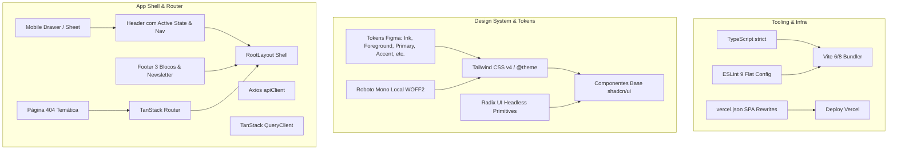

# Plano de Implementação: Fundação (NTF Marketplace | Kurio)

> Baseado na especificação em [_specs/fundation.spec.md](file:///home/savior/coding/nft-marketplace/_specs/fundation.spec.md) e na especificação-mãe [_specs/base.spec.md](file:///home/savior/coding/nft-marketplace/_specs/base.spec.md).  
> **Escopo da Fundação:** Tooling (TypeScript, ESLint estrito, Vite), Tailwind CSS + shadcn/ui configurados com os tokens do Figma, casca da aplicação (Header com navegação responsiva e Sheet mobile, Footer institucional), componentes base Radix/shadcn, rotas base com página 404 via TanStack Router, instâncias de infraestrutura (Axios e TanStack QueryClient) e configuração de deploy na Vercel com SPA rewrites.  
> **Fora de escopo desta etapa:** Telas completas de negócio, contratos REST, handlers MSW e Socket.IO.

---

## User Review Required

> [!IMPORTANT]
> **Respostas do Usuário já Incorporadas:**
> 1. **Deploy:** Vercel com arquivo `vercel.json` contendo regras de rewrite para SPA.
> 2. **Ícones:** Componentes SVG locais baseados nos vetores exatos do Figma (`Iconly`, redes sociais, providers de carteira, etc.).
> 3. **Badge do Carrinho:** Inicializado com valor default `0` (oculto quando for 0 para preservar fidelidade visual inicial sem dados fictícios).

> [!NOTE]
> **Migração de JavaScript para TypeScript:**
> O projeto original continha `App.jsx` e `main.jsx`. Eles serão substituídos por `main.tsx` e a árvore tipada do TanStack Router sob `src/`.

---

## Arquitetura da Fundação



---

## Proposed Changes

---

### 1. Tooling, Configurações e TypeScript

Configurar TypeScript estrito, scripts padronizados e integração limpa do ESLint.

#### [NEW] `tsconfig.json`
- Configuração TypeScript com `strict: true`, `target: ES2022`, `moduleResolution: Bundler`, suporte a JSX React 19 e paths alias `@/*` apontando para `./src/*`.

#### [NEW] `tsconfig.node.json`
- Configuração para arquivos de tooling Vite e scripts de configuração Node.

#### [MODIFY] `package.json`
- Adicionar dependências essenciais:
  - `@tanstack/react-router`
  - `@tanstack/react-query`
  - `axios`
  - `clsx`, `tailwind-merge`, `class-variance-authority`
  - `@radix-ui/react-dialog`, `@radix-ui/react-separator`, `@radix-ui/react-slot`
  - `@fontsource/roboto-mono`
  - Dependências de desenvolvimento: `typescript`, `@types/node`, `@types/react`, `@types/react-dom`, `@tailwindcss/vite`, `tailwindcss`.
- Atualizar scripts:
  - `"dev": "vite"`
  - `"build": "tsc && vite build"`
  - `"lint": "eslint ."`
  - `"typecheck": "tsc --noEmit"`
  - `"preview": "vite preview"`

#### [MODIFY] `vite.config.ts`
- Renomear de `vite.config.js` para `vite.config.ts`.
- Configurar `@vitejs/plugin-react`, `@tailwindcss/vite` e `path.resolve` para o alias `@`.

#### [MODIFY] `eslint.config.js`
- Adicionar suporte completo a TypeScript (`ts.configs.recommended`) e regras de hooks do React 19 com exclusão do diretório `dist`.

---

### 2. Design Tokens e Estilização Global

Mapeamento exato dos tokens inspecionados no Figma para o Tailwind e CSS variables.

#### [MODIFY] `src/index.css`
- Importar fonte `Roboto Mono` via `@fontsource/roboto-mono` com `font-display: swap`.
- Definir `@theme` / variáveis de design tokens com fidelidade absoluta:
  ```css
  --color-ink: #140D0A;
  --color-foreground: #F5F1EB;
  --color-primary: #D28A4C;
  --color-accent: #E89B55;
  --color-secondary-text: #CFB28C;
  --color-secondary-color: #B39463;
  --color-surface-card: #241612;
  --color-surface-raised: #2F1D15;
  --color-surface-dark: #38220F;
  --color-border-dark: #3F2319;
  --color-border-soft: #55321F;
  --color-coral: #F0805F;
  ```
- Configurar resets globais para acessibilidade:
  - Background `var(--color-ink)` e texto `var(--color-foreground)`.
  - Família tipográfica padrão: `'Roboto Mono', monospace`.
  - Estilos de foco visível com anel de destaque primário (`focus-visible:ring-2 focus-visible:ring-[#D28A4C]`).
  - Respeito a `prefers-reduced-motion`.

#### [NEW] `src/lib/utils.ts`
- Implementar utilitário `cn(...inputs)` combinando `clsx` e `tailwind-merge` para classes condicionais limpas.

---

### 3. Componentes de Ícones Locais do Figma

Para cumprir a resposta 2 do usuário ("Exportar os SVGs exatos do figma") e a RN-23/RN-24 sem dependências externas.

#### [NEW] `src/components/icons/index.tsx`
- Componentes SVG puros, acessíveis e tipados (`SVGProps<SVGSVGElement>`):
  - `KurioLogo`: Marca nominativa com tracking ajustado.
  - `LogoutIcon`: Ícone `Iconly/Curved/Logout` do botão de login.
  - `CartIcon`: Ícone de sacola/carrinho com suporte a viewBox responsivo.
  - `SearchIcon`: Ícone de busca 20x20px.
  - `StarIcon`: Ícone `Iconly/Bold/Star` para ratings.
  - `DeleteIcon`: Ícone de lixeira `Iconly/Curved/Delete`.
  - `ArrowDownIcon` e `ArrowRightIcon`.
  - `HeartIcon`: Ícone de favoritar.
  - Redes Sociais: `FacebookIcon`, `InstagramIcon`, `TwitterIcon`, `LinkedinIcon`, `UnionIcon`.
  - Provedores de Carteira: `MetaMaskIcon`, `CoinbaseIcon`, `WalletConnectIcon`.

---

### 4. Componentes Base Primitivos (shadcn/ui)

Adaptados para o tema escuro do Figma e tipografia monospaçada.

#### [NEW] `src/components/ui/button.tsx`
- Componente `Button` construído com `class-variance-authority` (cva) e `Slot`:
  - Variantes: `primary` (fill `#D28A4C`, text `#140D0A`, hover mais claro), `outline` (border 1px `#D28A4C`, text `#E89B55`), `secondary` (fill `#241612`, text `#F5F1EB`), `ghost` (transparente).
  - Tamanhos: `sm` (32px), `md` (40px), `lg` (45px), `icon` (40x40px).
  - Suporte a acessibilidade: área de toque mínima em mobile (44px) e estado `loading` com spinner acessível.

#### [NEW] `src/components/ui/input.tsx`
- Campo de entrada com altura padrão de 40px, fundo `#140D0A` ou `#38220F`, borda `#3F2319`, foco `#D28A4C`, placeholder `#B39463` e tipografia `Roboto Mono` 14px/15px.

#### [NEW] `src/components/ui/card.tsx`
- Primitivos `Card`, `CardHeader`, `CardTitle`, `CardDescription`, `CardContent`, `CardFooter` com fundo `#241612` e borda `#3F2319`.

#### [NEW] `src/components/ui/badge.tsx`
- Primitivo `Badge` com suporte às variantes `default`, `counter` (círculo primário do carrinho), `edition` (pílulas de edição de NFT) e `status`.

#### [NEW] `src/components/ui/separator.tsx`
- Divisória baseada em `@radix-ui/react-separator`, com variantes `hairline` (0.3px `#D28A4C`) e `standard` (1px `#3F2319`).

#### [NEW] `src/components/ui/sheet.tsx`
- Drawer lateral baseado em `@radix-ui/react-dialog`, suporte a animação suave da direita para a esquerda, bloqueio de rolagem (scroll lock), focus trap e fechamento via <kbd>Esc</kbd> ou overlay.

#### [NEW] `src/components/ui/dialog.tsx`
- Modal primitivo baseado em `@radix-ui/react-dialog` com backdrop escuro e foco controlado.

#### [NEW] `src/components/ui/skeleton.tsx`
- Componente de loading com efeito shimmer e respeito a `prefers-reduced-motion`.

---

### 5. Casca da Aplicação (Shell) & Navegação Responsiva

Construção do Header, MobileNav e Footer conforme o layout inspecionado no Figma.

#### [NEW] `src/components/layout/Header.tsx`
- Header com duas composições:
  - **Desktop (≥ 1024px):** Container de 1200px, Logo KURIO, 4 links ("Início", "Mercado", "Criadores", "Aprenda") com underline ativo condicional via rota atual do TanStack Router (`Active=Home` ou `Active=Market`), ícone de busca, ícone de carrinho com badge condicional (oculto quando contagem for `0`), botão "Entrar" estilizado. Linha divisória inferior ultrafina de 0.3px.
  - **Mobile (< 1024px):** Barra compacta com Logo KURIO, botão hambúrguer para disparar o `MobileNav` (Sheet), busca e carrinho com badge.
- Acessibilidade: Botões com `aria-label` explícito, teclado totalmente funcional.

#### [NEW] `src/components/layout/MobileNav.tsx`
- Gaveta lateral deslizante que exibe a navegação completa, botão de autenticação e opções institucionais no mobile com área de toque mínima de 44x44px.

#### [NEW] `src/components/layout/Footer.tsx`
- Componente fiel aos 3 blocos do Figma:
  1. **Bloco Superior:** Destaques de confiança ("Segurança da carteira", "Criadores em destaque", "Alertas de lançamentos") + Formulário de Newsletter (input acoplado com botão "Enviar").
  2. **Faixa Intermediária:** Logo KURIO, slogan da marca e contatos oficiais (`contato@email.com`, telefone).
  3. **Bloco Inferior:** 3 colunas de links ("Meu perfil", "Central de ajuda", "Coleções"), botões quadrados de redes sociais (Facebook, Instagram, Twitter, Linkedin, Union), badge institucional de carteiras compatíveis (`METAMASK • WALLETCONNECT • COINBASE`) e copyright.
- Layout adaptável sem overflow para 390px, 768px e 1440px.

#### [NEW] `src/components/layout/RootLayout.tsx`
- Shell unificado contendo o `<Header />`, container principal `<main className="flex-1">` onde o `<Outlet />` do roteador renderiza o conteúdo, e o `<Footer />`.

---

### 6. Roteamento Base e Tratamento 404 (TanStack Router)

Declaração de rotas da aplicação herdadas da `base.spec.md` e tela 404.

#### [NEW] `src/router/index.tsx`
- Configuração do roteador com `createRouter`, `createRootRoute` e `createRoute`.
- Registro das 9 rotas previstas:
  - `/` -> Início / Catálogo
  - `/nft/$id` -> Detalhes do NFT
  - `/carrinho` -> Carrinho
  - `/pagamento` -> Checkout
  - `/confirmacao` -> Confirmação de pedido
  - `/login` -> Login
  - `/cadastro` -> Cadastro
  - `/perfil` -> Perfil do colecionador
  - `/carteiras` -> Minhas carteiras
- Rota de fallback `notFoundComponent` apontando para a página 404 estilizada.

#### [NEW] `src/pages/NotFoundPage.tsx`
- Tela 404 temática:
  - Fundo `#140D0A`, card centralizado `#241612`, borda `#3F2319`.
  - Código "404" em `Display/43 Bold`, título "Obra digital ou página não encontrada".
  - Mensagem explicativa amigável.
  - Botão primário "Voltar para o Início" navegando para `/`.

#### [NEW] `src/pages/RoutePlaceholderPage.tsx`
- Componente utilitário temporário para as rotas da fundação que renderiza o nome da rota e confirma que a casca (Header + Footer) está ativa e navegável em cada URL antes da implementação das telas completas nas specs seguintes.

---

### 7. Clientes de Infraestrutura e Entrypoint

Instâncias tipadas de Axios e QueryClient.

#### [NEW] `src/lib/api-client.ts`
- Instância `apiClient` configurada com `axios.create`:
  - `baseURL: import.meta.env.VITE_API_URL || '/api'`
  - `timeout: 15000`
  - `headers: { 'Content-Type': 'application/json' }`
- Tipagem base de erros da API (`ApiErrorResponse`).

#### [NEW] `src/lib/query-client.ts`
- Instância `queryClient` (TanStack Query) com:
  - `staleTime: 1000 * 60 * 2` (2 minutos padrão)
  - `refetchOnWindowFocus: false`
  - `retry: 1`

#### [NEW] `src/main.tsx`
- Entrypoint principal montando `RouterProvider` com `QueryClientProvider`.
- Importação dos estilos globais `src/index.css`.

#### [DELETE] `src/App.jsx` e `src/main.jsx`
- Remoção dos arquivos JavaScript originais não tipados gerados pelo scaffolding inicial.

#### [MODIFY] `index.html`
- Ajustar metatags: `lang="pt-BR"`, título `"Kurio | Marketplace de NFTs"`, descrição coerente e pré-conexão opcional para fontes locais.

#### [NEW] `vercel.json`
- Configuração de deploy na Vercel com regras de rewrite para Single Page Application (SPA):
  ```json
  {
    "rewrites": [
      {
        "source": "/(.*)",
        "destination": "/index.html"
      }
    ]
  }
  ```

---

## Verification Plan

### Testes Automatizados e Checagens de Código
1. **Checagem de Tipos (TypeScript):**
   ```bash
   npm run typecheck
   ```
   *Critério de sucesso:* Saída sem erros (`0 errors`).
2. **Qualidade e Estilo (ESLint):**
   ```bash
   npm run lint
   ```
   *Critério de sucesso:* Saída sem erros ou avisos de lint.
3. **Build de Produção (Vite):**
   ```bash
   npm run build
   ```
   *Critério de sucesso:* Código compilado e empacotado na pasta `dist/` com sucesso.

### Verificação Manual e Acessibilidade
1. **Navegação do Shell e Rotas:**
   - Iniciar servidor de desenvolvimento (`npm run dev`).
   - Acessar `http://localhost:5173/` e verificar a renderização do Header, Footer e conteúdo central.
   - Clicar nos links de navegação e verificar a atualização da URL e o estado visual ativo no Header (`Active=Home` vs `Active=Market`).
   - Acessar uma rota desconhecida (ex: `http://localhost:5173/url-aleatoria`) e verificar a exibição da página 404 temática com botão de retorno funcional.
2. **Responsividade em 3 Breakpoints:**
   - **Desktop (1440px):** Container de 1200px, 4 links visíveis no Header, Footer em 3 blocos bem distribuídos.
   - **Tablet (768px):** Composição fluida sem scroll horizontal.
   - **Mobile (390px):** Header compacto com botão de menu hambúrguer, abertura do Drawer lateral com foco acessível e fechamento com <kbd>Esc</kbd>.
3. **Acessibilidade por Teclado:**
   - Navegar exclusivamente com a tecla <kbd>Tab</kbd> por todos os elementos interativos do Header e Footer, verificando anéis de foco visíveis em `#D28A4C`.
