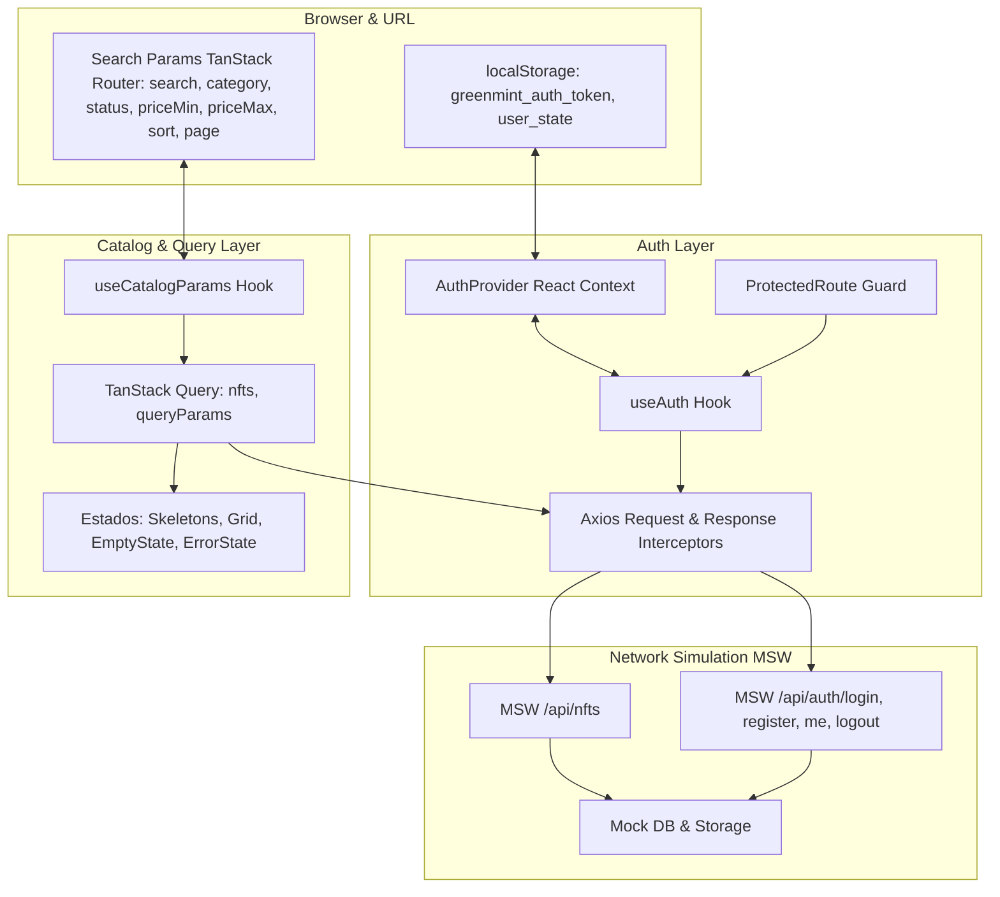

# Plano de Implementação: Sessão, Autenticação e Catálogo Inicial (Itens 03 e 04)

> **Baseado na especificação:** [_specs/sessao-auth-e-catalogo-inicio.spec.md](file:///home/savior/coding/nft-marketplace/_specs/sessao-auth-e-catalogo-inicio.spec.md)  
> **Specs herdadas:** [_specs/base.spec.md](file:///home/savior/coding/nft-marketplace/_specs/base.spec.md), [_specs/fundation.spec.md](file:///home/savior/coding/nft-marketplace/_specs/fundation.spec.md) e [_specs/contratos-e-mocks.spec.md](file:///home/savior/coding/nft-marketplace/_specs/contratos-e-mocks.spec.md)  
> **Objetivo:** Implementar a camada completa de autenticação e sessão de usuários (Login, Cadastro, Logout, Persistência em `localStorage`, Expiração, Proteção de rotas com retorno ao fluxo via `redirect`, Isolamento estrito de cache e Merge silencioso de carrinho no login) e a experiência de descoberta da página inicial (Hero Banner com NFT em destaque, barra de ferramentas de catálogo com busca textual debounced, filtros combináveis de categoria, status e preço em ETH, ordenação e paginação sincronizadas na URL via search params do TanStack Router, cards de NFT com tiragens, skeletons com shimmer para CLS = 0, empty state e tratamento de erros).

---

## User Review Required

> [!IMPORTANT]
> **Decisões do Usuário Incorporadas na Seção 5 da Spec:**
> 1. **Merge Silencioso de Carrinho:** No sucesso do login, o hook de autenticação aciona automaticamente `mergeGuestCartIntoUserCart(user.id)`, unificando o carrinho de visitante ao do colecionador sem interromper o redirecionamento.
> 2. **Filtros no Mobile:** Conforme o frame mobile do Figma ([`14:5226`](https://www.figma.com/design/Ff0SksUi7UFtPWUO8kyNtw/Frontend-Challenge?node-id=14-5226)), a interface mobile exibe um botão de filtros com badge de contagem que abre um Drawer/Sheet lateral deslizante contendo os mesmos controles da sidebar desktop.
> 3. **Ação "Esqueceu sua senha?":** Implementação 100% simulada através de um `<Dialog>` acessível do Radix/shadcn informando que o ambiente é simulado para avaliação e apresentando as credenciais de teste disponíveis (Alice Vance e Bob Martinez).

---

## Arquitetura de Estados e Fluxo de Dados



---

## Proposed Changes

---

### Passo 1: Camada de Autenticação, Tokens e Sessão (`src/features/auth/`)

Centralizar o estado global da sessão, persistência segura de tokens e integração com o Axios e TanStack Query.

#### [NEW] `src/features/auth/types.ts`

- Tipos de estado da sessão (`AuthState`), credenciais e payloads estendidos a partir de `src/contracts/auth.ts`:
  ```typescript
  import type { UserDTO } from "@/contracts";

  export interface AuthState {
    user: UserDTO | null;
    token: string | null;
    isAuthenticated: boolean;
    isLoading: boolean;
  }
  ```

#### [NEW] `src/features/auth/auth-storage.ts`

- Utilitário seguro para leitura e gravação do token no `localStorage` com chave `greenmint_auth_token`.
- Helper `parseJwtPayload(token: string)` para extrair claims (`sub`, `email`, `role`, `exp`).
- Helper `isTokenExpired(token: string): boolean` utilizando relógio unificado (RN-16).

#### [NEW] `src/features/auth/auth-context.tsx`

- `AuthContext` e `AuthProvider` envolvendo a aplicação:
  - Inicialização assíncrona: verifica token armazenado; se válido, dispara `GET /api/auth/me` para hidratar perfil; se expirado, limpa armazenamento local.
  - Função `login(credentials: LoginRequest): Promise<void>`:
    - Chama `POST /api/auth/login`.
    - Persiste token e atualiza estado.
    - Aciona `mergeGuestCartIntoUserCart(user.id)` (Decisão 1 do usuário).
    - Invalida queries de usuário.
  - Função `register(data: RegisterRequest): Promise<void>`:
    - Chama `POST /api/auth/register`.
    - Persiste token e atualiza estado.
    - Aciona merge silencioso de carrinho.
  - Função `logout(): Promise<void>`:
    - Chama `POST /api/auth/logout`.
    - Remove token.
    - Limpa cache privado (`queryClient.clear()`).
    - Desconecta listeners de socket se houver.
- Hook `useAuth()` com tipagem segura e erro informativo caso usado fora do provider.

#### [MODIFY] `src/lib/api-client.ts`

- Configurar interceptores do Axios:
  - **Request Interceptor:** Injeta automaticamente `Authorization: Bearer <token>` se houver token no `authStorage`.
  - **Response Interceptor:** Detecta erro 401 (`UNAUTHORIZED`) em chamadas autenticadas; se o erro for de token expirado ou inválido, limpa o token e despacha evento para redirecionar ao login com `redirect=[url_atual]&reason=expired`.

#### [NEW] `src/components/auth/ProtectedRoute.tsx`

- Componente de guarda para rotas restritas (`/perfil`, `/carteiras`, `/pagamento`):
  - Enquanto `isLoading` for verdadeiro, renderiza tela de carregamento neutra.
  - Se `!isAuthenticated`, redireciona via TanStack Router para `/login?redirect=${encodeURIComponent(location.href)}`.
  - Se autenticado, renderiza o `children` normalmente.

---

### Passo 2: Telas de Login e Cadastro (`src/pages/`)

Construção das interfaces de autenticação com total fidelidade ao layout do Figma (Desktop ~460px card, Mobile 414px) e componentes de feedback.

#### [NEW] `src/components/auth/ForgotPasswordDialog.tsx`

- Dialog temático (fundo `Color/Surface Card`, borda `Color/Border Soft`) exibindo:
  - Título: *"Recuperação de Acesso (Ambiente Simulado)"*.
  - Informações de avaliação: explica que não há envio de e-mails em ambiente simulado e lista as contas de demonstração:
    - **Alice Vance:** `alice@greenmint.io` (Senha: `Senha123!`)
    - **Bob Martinez:** `bob@greenmint.io` (Senha: `Senha456!`)
  - Botão de fechar primário.

#### [NEW] `src/pages/LoginPage.tsx` (substitui RoutePlaceholderPage em `/login`)

- Layout centralizado conforme frame Figma Desktop `9:115` e Mobile `16:1022`:
  - Card centralizado com padding 32px a 40px, borda sutil, título *"Acesse sua conta"*.
  - Inputs com labels associados, foco visual `focus-visible:ring-primary`.
  - Validação síncrona de preenchimento e formato de e-mail.
  - Alerta de erro acessível no topo do formulário em caso de HTTP 401 ("E-mail ou senha incorretos.").
  - Botão "Esqueceu sua senha?" acionando `ForgotPasswordDialog`.
  - Botão primário "Entrar" com estado desabilitado e loading (`isPending`).
  - Link de alternância: *"Ainda não tem conta? Criar conta"* apontando para `/cadastro`.
  - Redirecionamento inteligente: após login bem-sucedido, direciona para `search.redirect` (se presente) ou `/`.

#### [NEW] `src/pages/RegisterPage.tsx` (substitui RoutePlaceholderPage em `/cadastro`)

- Layout conforme frame Figma Desktop `9:1022` e Mobile `16:1228`:
  - Título *"Crie sua conta de colecionador"*.
  - Campos: Nome completo, E-mail, Senha e Confirmação de senha.
  - Validação síncrona: senha mínima de 8 caracteres e correspondência exata.
  - Tratamento de erro 409 (`CONFLICT`): mensagem de erro vinculada via `aria-describedby` ao campo de e-mail ("Este e-mail já está cadastrado no GreenMint.").
  - Botão primário "Criar conta" com estado desabilitado e spinner.
  - Link *"Já possui uma conta? Entrar"* apontando para `/login`.

---

### Passo 3: Atualização do Header com Perfil do Colecionador (`src/components/layout/Header.tsx`)

#### [MODIFY] `src/components/layout/Header.tsx` e `MobileNav.tsx`

- Integrar com `useAuth()`:
  - **Quando `!isAuthenticated`:** Exibe botão original "Entrar" direcionando para `/login`.
  - **Quando `isAuthenticated`:** Exibe componente de perfil do colecionador:
    - Botão com avatar (ou círculo com iniciais do nome) e nome do usuário.
    - Menu suspenso (Dropdown) com:
      - E-mail e status do colecionador.
      - Link para "Meu Perfil" (`/perfil`).
      - Link para "Minhas Carteiras" (`/carteiras`).
      - Divisória sutil.
      - Opção "Sair da conta" com ícone de logout, disparando `logout()`.
  - No menu mobile (`MobileNav.tsx`): exibir opções de perfil e botão de logout quando autenticado.

---

### Passo 4: Sincronização de Search Params e Consultas do Catálogo (`src/features/catalog/`)

Conectar a URL (TanStack Router search params) às queries remotas de forma determinística e reativa.

#### [NEW] `src/features/catalog/types.ts`

- Tipos estritos para os search params da Home:
  ```typescript
  import type { NftCategory, NftSortOption, NftStatus } from "@/contracts";

  export interface CatalogSearchParams {
    search?: string;
    category?: NftCategory;
    status?: NftStatus;
    priceMin?: string;
    priceMax?: string;
    sort?: NftSortOption;
    page?: number;
  }
  ```

#### [NEW] `src/features/catalog/api.ts`

- Função de busca consumindo o `apiClient`:
  ```typescript
  import { apiClient } from "@/lib/api-client";
  import type { PaginatedResponse, NftSummaryDTO, NftQueryParams } from "@/contracts";

  export async function getCatalogNfts(params: NftQueryParams, signal?: AbortSignal): Promise<PaginatedResponse<NftSummaryDTO>> {
    const response = await apiClient.get<PaginatedResponse<NftSummaryDTO>>("/nfts", {
      params,
      signal,
    });
    return response.data;
  }
  ```

#### [NEW] `src/features/catalog/hooks/useCatalogQuery.ts`

- Hook customizado integrando TanStack Query:
  - `queryKey: ['nfts', searchParams]`
  - Repassa `signal` do QueryClient para permitir cancelamento imediato de buscas anteriores (prevenindo respostas fora de ordem conforme RN-05 e EC-08).
  - Mantém dados anteriores visíveis durante transição de página (`placeholderData: keepPreviousData`).

---

### Passo 5: Componentes da Tela Inicial e Catálogo (`src/components/catalog/`)

Construir a interface visual completa da Home e os controles de filtro.

#### [NEW] `src/components/catalog/HeroBanner.tsx`

- Seção Hero conforme Figma `2:2`:
  - Dimensões e espaçamentos fiéis (1200px container, gap 96px).
  - Título `Display/43 Bold` ("SEJA DONO DO FUTURO DIGITAL").
  - Botão "EXPLORAR" com rolagem suave para `#catalogo`.
  - Card lateral com NFT de destaque (imagem 450x450px com borderRadius 24px, metadados de preço e autor).

#### [NEW] `src/components/catalog/CatalogToolbar.tsx`

- Barra superior da listagem:
  - Campo de busca textual com ícone e debounce de 350ms (atualizando `search` na URL e resetando `page` para 1).
  - Abas de Categoria com scroll horizontal suave em mobile ("Todos os NFTs", "Arte", "Colecionáveis", "Música", "Fotografia").
  - Select / Dropdown de ordenação com indicador ativo sublinhado na cor primária.
  - Botão de filtro mobile/tablet com badge exibindo contagem de filtros aplicados.

#### [NEW] `src/components/catalog/CatalogSidebarFilters.tsx`

- Sidebar desktop (310px) fixa à esquerda:
  - Grupo de Categorias com contadores determinísticos.
  - Grupo de Status ("À venda", "Últimas edições", "Esgotado").
  - Grupo de Faixa de Preço em ETH com inputs `priceMin` e `priceMax` e botão "Aplicar".
  - Botão "Limpar Filtros".

#### [NEW] `src/components/catalog/CatalogMobileFiltersSheet.tsx`

- Drawer/Sheet deslizante do Radix/shadcn para mobile e tablet (Decisão 2 do usuário):
  - Acionado pelo botão de filtros da toolbar.
  - Contém todos os controles da sidebar adaptados para toque (área mínima 44x44px).
  - Botão "Ver resultados" e botão "Limpar".

#### [NEW] `src/components/catalog/NftCard.tsx`

- Card individual de NFT conforme Figma:
  - Imagem com aspect ratio travado e dimensões reservadas (zero layout shift).
  - Tag/Badge com categoria/status.
  - Título do NFT e coleção.
  - Preço em ETH formatado como string decimal com precisão.
  - Tiragem de edições (disponíveis / total).
  - Link semântico para a tela de detalhes `/nft/$id`.

#### [NEW] `src/components/catalog/NftCardSkeleton.tsx`

- Skeleton com efeito de shimmer que reproduz as dimensões exatas de `NftCard.tsx` (imagem quadrada, badges, linhas de texto e botão), garantindo CLS = 0.
- Desativação do shimmer se `prefers-reduced-motion` estiver ativo.

#### [NEW] `src/components/catalog/CatalogEmptyState.tsx`

- Estado de catálogo vazio:
  - Ilustração e texto: *"Nenhum NFT encontrado para os filtros selecionados"*.
  - Botão "Limpar Filtros" que restaura a URL para os valores padrão.

#### [NEW] `src/components/catalog/CatalogErrorState.tsx`

- Card de erro amigável com mensagem tipada da API e botão "Tentar Novamente" (`refetch`).

#### [NEW] `src/components/catalog/CatalogPagination.tsx`

- Controles de paginação com botões "Anterior", números de página e "Próximo".
- Destaque visual da página ativa (`Color/Primary`).
- Desabilita botões inválidos preservando foco acessível.

#### [NEW] `src/components/catalog/PromoCardsSection.tsx` e `MintDiaryBlogSection.tsx`

- Blocos complementares do Figma na Home:
  - Dois cards promocionais lado a lado com borderRadius 18px e botões CTA.
  - Seção do blog com 4 cards editoriais (imagem, data, título e link informativo).

---

### Passo 6: Integração da Página Inicial e Rotas no TanStack Router

#### [NEW] `src/pages/HomePage.tsx`

- Composição da tela inicial integrando Hero, Toolbar, Sidebar, Mobile Sheet, Grid, Skeletons, Empty/Error states, Paginação, Promoções e Blog.

#### [MODIFY] `src/router/index.tsx`

- Atualizar rotas para apontar para as páginas reais:
  - Rota `/` $\rightarrow$ `HomePage` (com validação de `searchParams` via TanStack Router).
  - Rota `/login` $\rightarrow$ `LoginPage`.
  - Rota `/cadastro` $\rightarrow$ `RegisterPage`.
- Configurar proteção em rotas restritas (`/perfil`, `/carteiras`, `/pagamento`) com `ProtectedRoute`.

---

### Passo 7: Testes Automatizados E2E com Playwright (`e2e/`)

Validar todos os critérios de aceite (CA-01 a CA-10).

#### [NEW] `e2e/auth.spec.ts`

- Teste 1: Login com credenciais válidas da Alice (`alice@greenmint.io` / `Senha123!`) $\rightarrow$ valida persistência do token, atualização do Header e redirecionamento.
- Teste 2: Login com credenciais inválidas $\rightarrow$ valida exibição do erro 401 e manutenção do e-mail no campo.
- Teste 3: Cadastro com e-mail duplicado (`alice@greenmint.io`) $\rightarrow$ valida mensagem de erro 409 no campo de e-mail.
- Teste 4: Cadastro de novo usuário $\rightarrow$ valida criação, autenticação automática e redirecionamento.
- Teste 5: Proteção de rota e retorno ao fluxo: navega para `/perfil` deslogado $\rightarrow$ é redirecionado para `/login?redirect=%2Fperfil` $\rightarrow$ faz login $\rightarrow$ é direcionado imediatamente para `/perfil`.
- Teste 6: Logout $\rightarrow$ valida remoção do token, limpeza do Header e restauração do estado de visitante.

#### [NEW] `e2e/catalog.spec.ts`

- Teste 1: Carregamento inicial da Home com 8 cards de NFT e skeletons.
- Teste 2: Busca textual debounced: digita "Cyber" $\rightarrow$ URL atualiza para `?search=Cyber` $\rightarrow$ grid exibe apenas resultados correspondentes.
- Teste 3: Filtro por categoria (ex: "Música") $\rightarrow$ URL atualiza e página reseta para 1.
- Teste 4: Paginação: clica na página 2 $\rightarrow$ URL atualiza para `?page=2` $\rightarrow$ exibe próximos 8 NFTs.
- Teste 5: Navegação por histórico do navegador: botão "Voltar" restaura filtros e página anteriores.
- Teste 6: Estado de catálogo vazio: filtra com termo inexistente $\rightarrow$ exibe Empty State $\rightarrow$ clica em "Limpar Filtros" $\rightarrow$ restaura o catálogo completo.
- Teste 7: Responsividade mobile (390px): abre Sheet de filtros, aplica categoria e fecha.

---

## Verification Plan

### Automated Tests

1. **Testes Unitários / Contratos Existentes:**
   ```bash
   npm test
   ```
2. **Checagem de Tipos (TypeScript):**
   ```bash
   npm run typecheck
   ```
3. **Linter (ESLint):**
   ```bash
   npm run lint
   ```
4. **Build de Produção:**
   ```bash
   npm run build
   ```
5. **Testes E2E (Playwright):**
   ```bash
   npx playwright test e2e/auth.spec.ts e2e/catalog.spec.ts
   ```

### Manual Verification

1. **Fluxo de Autenticação e Proteção:**
   - Acessar `http://localhost:5173/perfil` sem estar logado $\rightarrow$ verificar redirecionamento para `/login?redirect=%2Fperfil`.
   - Fazer login com `alice@greenmint.io` e `Senha123!` $\rightarrow$ verificar redirecionamento automático de volta para `/perfil`.
   - Clicar em "Esqueceu sua senha?" na tela de login $\rightarrow$ verificar abertura do Dialog com as credenciais simuladas.
   - No Header, verificar o avatar/nome de Alice e clicar em "Sair" $\rightarrow$ verificar que o Header volta ao estado deslogado com o botão "Entrar".
2. **Catálogo, Filtros e Search Params:**
   - Na página inicial `/`, digitar "Cyber" no campo de busca $\rightarrow$ verificar debounce e URL atualizada para `?search=Cyber`.
   - Alternar entre as abas de categoria ("Arte", "Colecionáveis", etc.) $\rightarrow$ verificar cards filtrados e URL com `category=...`.
   - Clicar na página 2 $\rightarrow$ verificar página atualizada e URL com `page=2`.
   - Recarregar a página (F5) $\rightarrow$ verificar que os filtros e a página se mantêm exatamente iguais.
   - Pressionar o botão "Voltar" do navegador $\rightarrow$ verificar retorno suave ao estado anterior.
   - Aplicar filtros que resultem em zero NFTs $\rightarrow$ verificar exibição do Empty State e testar botão "Limpar Filtros".
3. **Responsividade Mobile:**
   - Reduzir viewport para 390px no DevTools.
   - Verificar ausência de overflow horizontal.
   - Clicar no botão de filtros na toolbar $\rightarrow$ verificar abertura fluida do Sheet lateral e aplicação de filtros.
